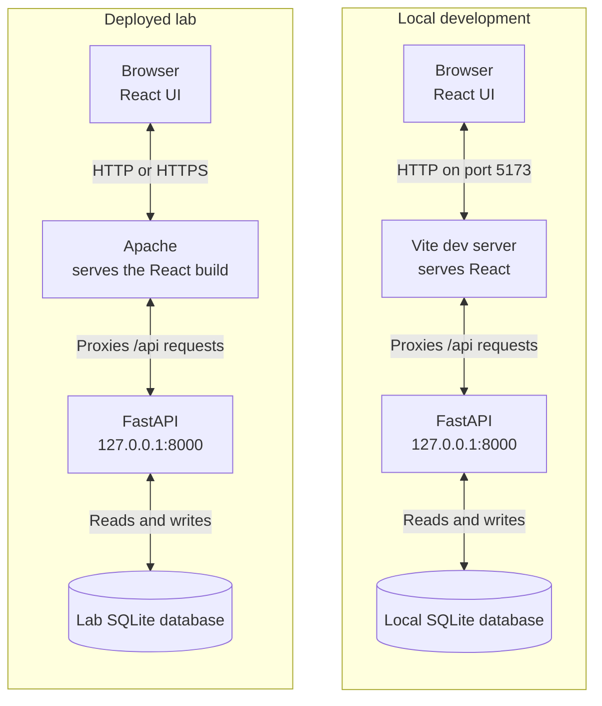

# Support ticket queue

A full-stack interview starter. The React frontend lists support tickets and lets users create new ones. FastAPI serves the API, and SQLite stores tickets between restarts. The database starts with three sample tickets, including an open and a resolved ticket.

## Architecture



### Deployed paths on the lab VM

| Component | Path | Purpose |
| --- | --- | --- |
| Apache virtual host | `/etc/apache2/sites-available/devlab.conf` | Serves the React site and proxies `/api/` requests to FastAPI. |
| React build | `/var/www/devlab/` | Contains the deployed `index.html` and frontend assets. |
| systemd service | `/etc/systemd/system/support-ticket-queue.service` | Starts FastAPI on `127.0.0.1:8000` and sets the database path. |
| Active backend release | `/srv/devlab/current/` | Symlink to the release the service is running. |
| FastAPI entry point | `/srv/devlab/current/app/main.py` | Defines the app, health endpoint, and ticket routes. |
| Backend releases | `/srv/devlab/releases/` | Holds release directories used for deployments and rollbacks. |
| Python environment | `/srv/devlab/.venv/` | Contains the service’s Python interpreter and dependencies. |
| Lab access settings | `/srv/devlab/.env` | Holds the sign-in settings loaded at startup. |
| SQLite database | `/srv/devlab/data/tickets.sqlite3` | Stores persistent ticket data and active browser sessions. |

## Run locally

Use Python 3.12 and Node.js 24 to match CI. From the repository root, start FastAPI in one terminal.

Copy the example to `backend/.env` if you’re setting up the project for the first time.

```sh
cd backend
cp -n .env.example .env
python3.12 -m venv .venv
source .venv/bin/activate
python -m pip install -r requirements.txt
python -m uvicorn app.main:app --reload --port 8000
```

In a second terminal, start the React development server from the repository root.

```sh
cd frontend
npm ci
npm run dev
```

### Verify the local integration

1. With both servers running, open the [local ticket queue](http://127.0.0.1:5173). If prompted, enter `local-test-token` and click **Open queue**.
2. In **New ticket**, enter a subject and description, then click **Create ticket**. Confirm that the new ticket appears at the top of the list with status **Open**.
3. Refresh the page and confirm that the ticket is still there. This checks that the frontend can create and reload a ticket through the API and that the backend saves it to SQLite.

Vite forwards `/api` requests to FastAPI on port `8000`. The database defaults to `backend/data/tickets.sqlite3` when started as shown, and `TICKET_DB_PATH` overrides its location. [Local API documentation](http://127.0.0.1:8000/docs)

### Run tests locally

Run the frontend tests from the repository root.

```sh
npm --prefix frontend ci
npm --prefix frontend test
```

Run the backend tests with the virtual environment active.

```sh
cd backend
python -m pip install -r requirements-test.txt
python -m pytest -q
```

The frontend suite simulates API responses. The backend suite uses a temporary SQLite database. Both run without starting development servers.

## CI and deployment

GitHub Actions deploys to the `devlab` lab environment from both `dev` and `main`. Pushes and merges to either branch run the workflows that match the changed files. A change to both components runs both workflows.

| Changed files | Workflow | What it does |
| --- | --- | --- |
| `frontend/**` | [Deploy frontend](.github/workflows/deploy-frontend.yml) | Runs the React tests, builds the frontend, and publishes it to `/var/www/devlab/`. |
| `backend/**` | [Deploy backend](.github/workflows/deploy-backend.yml) | Runs the FastAPI tests, deploys to `/srv/devlab/`, and checks the service and API after restarting. |

For an interview branch, push your changes and open **Actions**. Choose the relevant workflow, select **Run workflow**, and choose the branch agreed with your interviewer.

Open the run for your commit to check the test and deployment results. A failing test stops deployment. After the relevant workflows succeed, open the lab URL provided by your interviewer and verify your change using the lab access token.

## Check the backend on the VM (This will be performed during interview)

Connect over SSH using the account and VM hostname provided by your interviewer.

```sh
ssh YOUR_VM_USER@YOUR_VM_HOST
```

Run these commands on the VM. FastAPI listens on its loopback interface.

```sh
systemctl status support-ticket-queue.service --no-pager
curl -fsS http://127.0.0.1:8000/health
curl -sS -o /dev/null -w '%{http_code}\n' http://127.0.0.1:8000/api/tickets
```

Expect `active (running)` from systemd, `{"status":"ok"}` from the health endpoint, and HTTP `401` for the ticket request without a session. To verify ticket data, enter the token at the lab URL provided by your interviewer.

If you have sudo access, use this command to check the recent backend logs.

```sh
sudo journalctl -u support-ticket-queue.service -n 50 --no-pager
```
